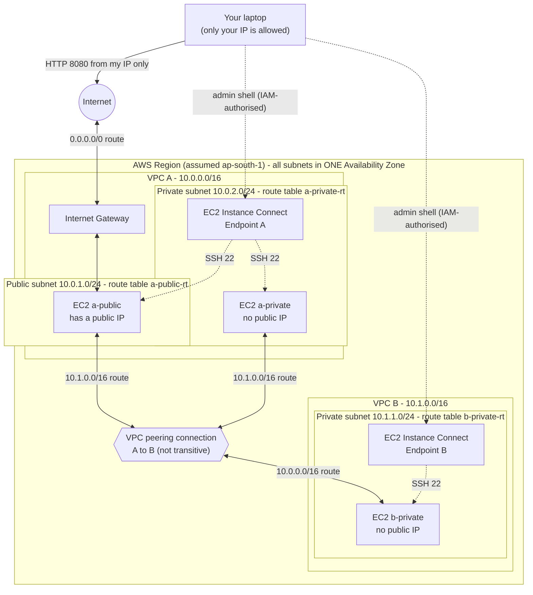

# AWS VPC Peering and Secure Network Connectivity

A beginner-friendly AWS networking project: two VPCs joined by VPC peering, with a public and private subnet, an Internet Gateway, and secure admin access to private servers (no public SSH, no bastion, no NAT).

> **Project status (please read):**
> ✅ Design, documentation, Terraform and offline tests are written and checked.
> ❌ **Not yet deployed to AWS. No AWS test results or screenshots exist yet.** Sections marked *EXPECTED* describe what should happen; replace them with real results after you test.
> This work is based on a text description of the reference diagram. The diagram image itself was not available when this was written.

## 1. Problem statement

By default, two VPCs cannot communicate. How can they exchange traffic privately, keep private servers unreachable from the internet, still let an administrator manage them, and cost very little?

## 2. Objectives

1. Two non-overlapping VPCs with a clear subnet plan.
2. VPC peering with correct routes on both sides.
3. One public instance (Internet Gateway) and two private instances.
4. Secure shell access to private instances without opening SSH/RDP to the internet.
5. Explain and demonstrate that peering is not transitive.
6. Tests, troubleshooting, cost control and cleanup.

## 3. Architecture



*(The diagram was written as text and not rendered locally. GitHub renders it. If it shows an error, paste `diagrams/architecture.mmd` into https://mermaid.live.)*

### Address plan

| Item | Reference diagram | This implementation |
|---|---|---|
| VPC A / VPC 1 | `28.0.0.0/16` | `10.0.0.0/16` |
| VPC B / VPC 2 | `28.200.0.0/16` | `10.1.0.0/16` |
| A public subnet | n/a | `10.0.1.0/24` |
| A private subnet | n/a | `10.0.2.0/24` |
| B private subnet | n/a | `10.1.1.0/24` |

Why the ranges changed: `docs/02-design.md` §2.1.

## 4. AWS services used

Amazon VPC (subnets, route tables, Internet Gateway, peering), Amazon EC2, security groups, EC2 Instance Connect Endpoint, IAM (your permissions). Terraform is optional.

## 5. Prerequisites

- An AWS account you may use for learning, signed in as an IAM user (not root).
- Basic browser skills. No prior AWS knowledge needed; start with `docs/01-concepts.md`.
- Your public IP address (for the one allowed web rule).
- A budget alert. Approval of the costs in §12.

## 6. Folder structure

```
aws-vpc-peering/
├── README.md
├── .gitignore
├── config/
│   ├── network-plan.json              plan as data (tested)
│   ├── user-data.sh.tpl               instance start-up script
│   └── iam-policy-eice-user-example.json   example, untested
├── diagrams/architecture.mmd
├── docs/                              concepts, design, guides, report, Q&A
├── scripts/connectivity-test.sh       run ON the instances
├── screenshots/CHECKLIST.md           what YOU must capture
├── terraform/                         optional IaC
└── tests/test_network_plan.py         offline tests
```

## 7. Implementation steps

1. Read `docs/01-concepts.md` and `docs/02-design.md`.
2. Read `docs/06-cost-and-cleanup.md`; set a budget alert; approve the costs.
3. Build, **either**
   - Console: `docs/03-console-deployment-guide.md` (recommended for learning), **or**
   - Terraform: `terraform/README.md`.
4. Test: `docs/04-testing.md`.
5. Capture screenshots: `screenshots/CHECKLIST.md`.
6. **Clean up the same day**: `docs/06-cost-and-cleanup.md`.

## 8. Configuration details

- Route tables: `docs/02-design.md` §2.3. Security groups: §2.4.
- Instances: Amazon Linux 2023, `t3.micro` (your account may differ), no key pair, IMDSv2 required, 8 GiB encrypted `gp3`.
- Start-up script runs a tiny Python web page on TCP 8080. It needs no internet, so private instances need no NAT.

## 9. Testing

Run the offline checks (no AWS needed):

```bash
python3 -m unittest discover -s tests -v
```

AWS tests T1-T10 are in `docs/04-testing.md`. Inside an instance:

```bash
./connectivity-test.sh <target-private-ip>
./connectivity-test.sh --internet
```

### Test results

| What | Result |
|---|---|
| Offline network-plan tests (10) | **Passed** when run in the build environment |
| Shell script syntax, Terraform format/syntax/reference check | **OK** in the build environment |
| `terraform validate` with the AWS provider | **Not run** (do it yourself) |
| AWS tests T1-T10 | **Not run yet.** Add your real results to `docs/04-testing.md` |

### EXPECTED (not yet observed) AWS results

- Peering status Active.
- Ping and HTTP between the VPCs work in both directions.
- `a-public` reaches the internet; `a-private` and `b-private` do not.
- Direct SSH from the internet times out.

## 10. Screenshots

**None captured yet.** The required list with exact filenames is in `screenshots/CHECKLIST.md`. After you capture them, embed them here, for example:

```markdown

```

## 11. Security considerations

- No inbound SSH/RDP from the internet; SSH only from endpoint security groups.
- Test page limited to one `/32` source IP.
- No key pair and no stored secrets; IMDSv2 required; encrypted volumes.
- Private subnets have no internet route.
- Hide account IDs in screenshots; never commit `*.tfstate`, `*.tfvars`, `*.pem`.
- Full reasoning: `docs/02-design.md`; production hardening: `docs/07-production-option.md`.

## 12. Cost considerations

Charges accrue for 3 EC2 instances, their EBS volumes and one public IPv4 address while they exist. Peering creation has no charge; same-AZ peering traffic is free, cross-AZ is not. The Instance Connect Endpoint has no additional charge per AWS documentation. No NAT gateway is used. Verify current prices for your Region. Details: `docs/06-cost-and-cleanup.md`.

## 13. Troubleshooting

`docs/05-troubleshooting.md` covers failed connectivity, overlapping CIDRs, missing routes, security-group restrictions and peering status.

## 14. Cleanup

Terminate instances → delete endpoints → delete peering → detach/delete IGW → delete subnets, route tables, security groups, VPCs. Exact order and verification: `docs/06-cost-and-cleanup.md`. Terraform users: `terraform destroy`.

## 15. Limitations and future improvements

Single AZ; no OS updates for private instances; whole-CIDR peering routes; same account and Region only. Future: Multi-AZ, Session Manager, VPC Flow Logs, Transit Gateway.

## 16. What I learned

*(Write this yourself after deploying. Suggested prompts: What surprised you about routing? What failed first? How did you debug it? Why is peering not transitive?)*

## 17. Project documents

| Document | Purpose |
|---|---|
| `docs/01-concepts.md` | Terms in simple English |
| `docs/02-design.md` | CIDR, subnet, route, security-group design |
| `docs/03-console-deployment-guide.md` | Click-by-click build |
| `docs/04-testing.md` | Tests and result tables |
| `docs/05-troubleshooting.md` | Fixes |
| `docs/06-cost-and-cleanup.md` | Charges and teardown |
| `docs/07-production-option.md` | Production design (not built) |
| `docs/08-project-report.md` | Formal report |
| `docs/09-interview-questions.md` | 25 Q&A |
| `docs/10-github-upload-guide.md` | Publishing steps |
| `docs/11-presentation-notes.md` | How to present |

## 18. GitHub usage

Clone, then read `docs/10-github-upload-guide.md` to publish your own copy.

```bash
git clone https://github.com/YOUR-USERNAME/aws-vpc-peering.git
cd aws-vpc-peering
python3 -m unittest discover -s tests -v
```

## 19. Final submission checklist

- [ ] Trainer confirmed this project is required, plus Region/deadline/format
- [ ] Built in AWS and all tests T1-T10 run; real results entered in `docs/04-testing.md`
- [ ] All screenshots in `screenshots/`, account IDs hidden
- [ ] README *Screenshots* and *What I learned* sections completed
- [ ] Report sections marked **[TO COMPLETE AFTER DEPLOYMENT]** filled in
- [ ] Everything cleaned up in AWS; billing checked next day
- [ ] No secrets, state files, or account IDs in the repository
- [ ] Repository link submitted
